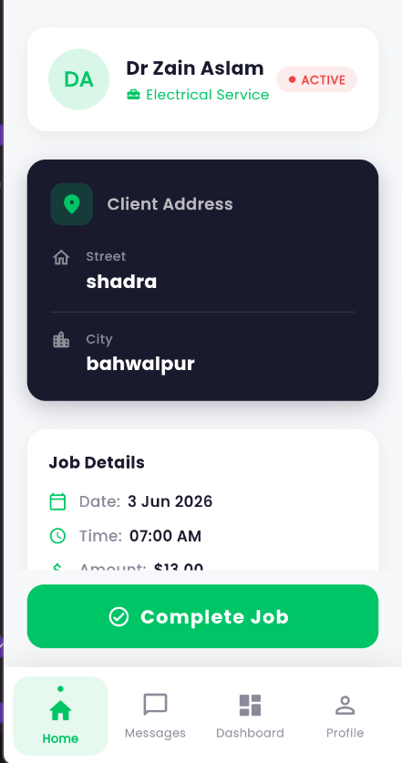

# Supabase Setup

1. Open the Supabase dashboard for the Homivo project.
2. Go to **SQL Editor** and create a new query.
3. Paste and run [`supabase/profile_setup.sql`](supabase/profile_setup.sql).
   Run it again if you previously used an older copy of the script.
4. Go to **Authentication > Providers > Email** and choose whether email
   confirmation should be required.
5. Test registration with a new client and a new provider account.

## Enable Realtime Bookings And Earnings

1. Open **SQL Editor** and create a new query.
2. Paste and run [`supabase/notification_setup.sql`](supabase/notification_setup.sql).
   Run the full file again if you previously used an older copy.
3. Create a booking from a client account.
4. Log in as the selected provider, accept the request, and enter the agreed
   quote.
5. Mark the job as completed. The provider earnings cards and the client's
   booking history update from the same realtime booking row.

The bookings table stores the accepted quote plus acceptance and completion
timestamps. Clients receive notifications when providers accept, reject, or
complete requests.

The app stores these profile fields in `public.profiles`:

- `full_name`
- `email`
- `phone`
- `address`
- `role`
- `specialty`

Provider profiles are readable from the client service directory. Client
profiles remain private to their owners.

## Create The First Admin

1. Register a normal client account in the app using the email that should
   become the admin account.
2. Open **Authentication > Users** in Supabase and copy that user's UUID.
3. Open **SQL Editor**, replace `PASTE_USER_UUID_HERE`, and run:

```sql
update public.profiles
set role = 'admin',
    updated_at = timezone('utc', now())
where id = 'PASTE_USER_UUID_HERE';

update auth.users
set raw_user_meta_data =
  coalesce(raw_user_meta_data, '{}'::jsonb) || '{"role":"admin"}'::jsonb
where id = 'PASTE_USER_UUID_HERE';
```

4. Log out and log back in with that account. It will open the admin side.

The admin side groups service providers by specialty and permanently deletes a
selected provider's profile and login account through a protected database
function.

Do not put a Supabase secret key in the Flutter app. Only the publishable key
belongs in `lib/core/constants/supabase_constants.dart`.
